<p><a href="https://github.com/ErykKozyra/terminalhinter">
  
</a></p>

The dropdown above is [terminalhinter](https://github.com/ErykKozyra/terminalhinter), my open source autocomplete for zsh, bash, fish and PowerShell. Folders, git branches, npm scripts and 700+ command line tools show up as you type, each with a short description.

```sh
npm i -g @erykkozyra/terminalhinter
thint init
```

[Website](https://erykkozyra.github.io/terminalhinter/) | [X](https://x.com/erykkozyradev) | [LinkedIn](https://www.linkedin.com/in/eryk-kozyra) | [npm](https://www.npmjs.com/package/@erykkozyra/terminalhinter)
